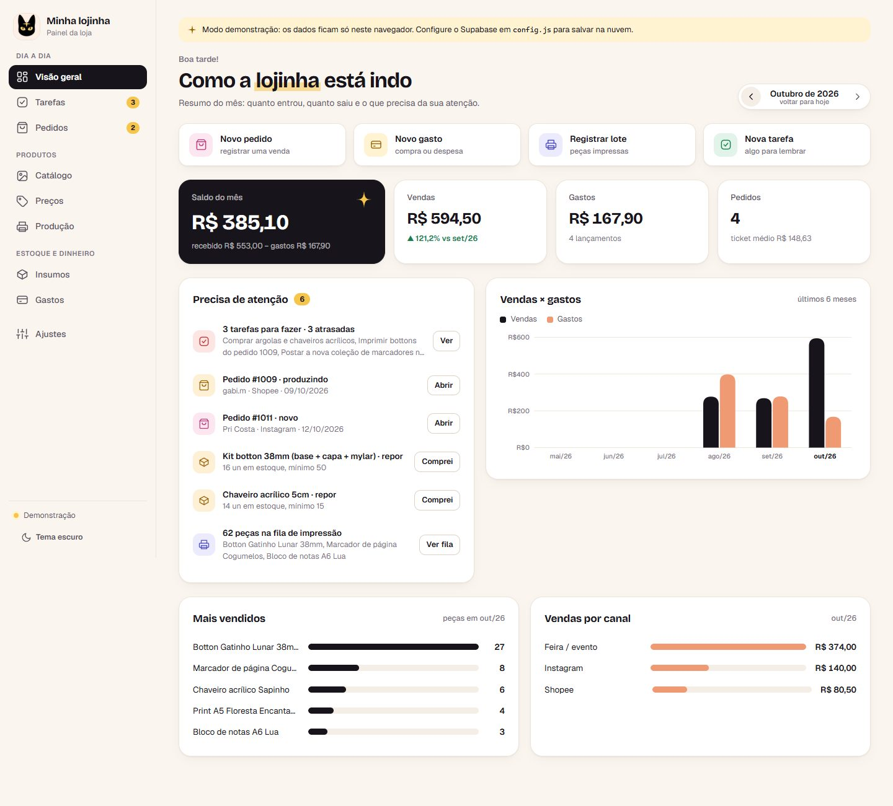
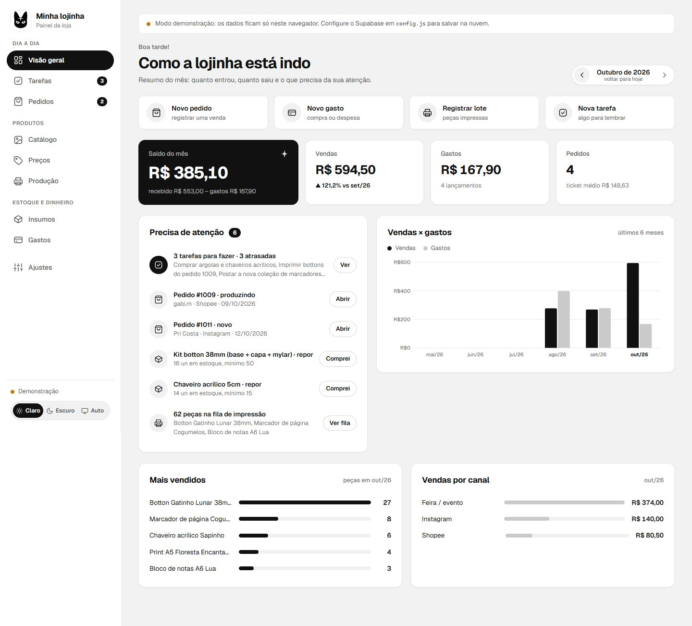

# Painel da Lojinha

A web dashboard to run a small handmade shop: pricing, a catalog with print settings, supplies, expenses, orders and production batches.

It is a static site (HTML, CSS and JS, no build step) that stores data in **Supabase**, behind a login.
Without Supabase configured, it runs in **demo mode**, with sample data saved only in the browser.



The interface is in Portuguese (pt-BR). Screen names below are shown as they appear in the app, with a translation in parentheses.

## Features

The sidebar groups the screens by topic. On mobile it becomes a slide-out menu plus a bottom bar with the most used screens.

| Group | Screen | What it does |
|---|---|---|
| Dia a dia (day to day) | **Visão geral** (overview) | Monthly profit and margin, sales, cash flow, a sales vs. expenses chart, products ranked by profit or by pieces, sales by channel and a "Precisa de atenção" (needs attention) list with one-click actions. |
| | **Tarefas** (tasks) | To-do list with due dates, priority and tags, grouped by overdue / today / next 7 days. |
| | **Pedidos** (orders) | Sales by channel, net amount after fees and shipping, invoice number and status. |
| Produtos (products) | **Catálogo** (catalog) | Product cards with artwork, ready stock and print settings (paper, size, color adjustments), plus a print queue. |
| | **Preços** (pricing) | Cost per piece from supplies, labor and waste, suggested price and margin per product. |
| | **Produção** (production) | Production batches; each batch adds ready pieces and consumes supplies. |
| Estoque e dinheiro (stock and money) | **Insumos** (supplies) | Supply stock, low-stock alerts and average cost. |
| | **Gastos** (expenses) | Everything paid out; purchases linked to a supply add to its stock. |
| | **Ajustes** (settings) | Default hourly rate, margin, fees and waste; appearance; backup and restore. |

### Appearance

The look is a clean black-and-white style. Color only appears as small status dots (green ok, orange attention, red problem).

- **Dark theme is the default.**
- The theme can be switched to **Claro / Escuro / Automático** (light / dark / auto, following the device) in the sidebar footer, in **Ajustes → Aparência**, or with the sun/moon button in the mobile top bar.
- The choice is saved per browser in `localStorage` (key `painel-tema`: `dark`, `light` or `auto`).

| Light theme | Mobile |
|---|---|
|  |  |

More screenshots are in [`docs/prints/`](docs/prints/).

### Design system

Colors, typography, spacing, radius and every reusable component are defined as design tokens and documented:

- [`docs/design-system.md`](docs/design-system.md): principles, tokens, title and text roles, components and usage rules.
- [`docs/styleguide.html`](docs/styleguide.html): a visual catalog of every token and component in both themes. Open the file in a browser (no server needed).
- [`public/tokens.css`](public/tokens.css): the tokens themselves. Components in `public/style.css` use only these variables.

#### Online versions

The design system is also published as two pages on Claude. Both are private: the owner has to share them from the page's Share menu before others can open them.

| Page | What it is | Use it to |
|---|---|---|
| [Design System](https://claude.ai/artifact/8bK2pvF5MFXNQtXGx6YQzB#readme) | The reference: brand book, every token with its usage note (light and dark values), and 21 components, each with a live preview and guidelines. Built in Claude's Design System format. | Look up rules and tokens, edit values and notes, and let Claude build new screens that follow the system. Its layout is fixed by the format, so it has no theme switch. |
| [Styleguide](https://claude.ai/artifact/VHWzGdb6avitJKevH6XUpT) | A one-page visual catalog: the same content as `docs/styleguide.html`, with the app's real CSS. | Check how everything looks, with a **Claro / Escuro** button (top right) that switches the whole page. View only. |

The source of truth stays in this repository (`public/tokens.css`, `public/style.css`, `docs/design-system.md`). When the design changes here, both pages need to be updated to match.

## 1. Create the database in Supabase (free)

1. Create an account at https://supabase.com and a new project (region: São Paulo).
2. Open **SQL Editor → New query**, paste the contents of [`supabase/schema.sql`](supabase/schema.sql) and click **Run**.
3. Create your user in **Authentication → Users → Add user → Create new user** (email and password; check *Auto Confirm User*).
4. Close public sign-ups: **Authentication → Sign In / Providers → turn off "Allow new users to sign up"**.
   This way only the users you create can log in.
5. In **Project Settings → API**, copy the **Project URL** and the **anon public** key into [`public/config.js`](public/config.js).

> The *anon* key is meant to live in the site. Data is protected by the login and by the database rules:
> each account only sees its own records. Never put the *service_role* key in the site.

## 2. Deploy the site

Only the `public/` folder is deployed. Pick one:

- **Netlify** (simplest): drag the `public` folder onto https://app.netlify.com/drop. To update, drag it again.
  If you connect the GitHub repository, `netlify.toml` already points to `public`.
- **Vercel**: import the repository; `vercel.json` already points to `public`.
- **Cloudflare Pages** or **GitHub Pages**: output directory `public`, no build command.

After deploying, go back to Supabase, open **Authentication → URL Configuration** and set the site address as
**Site URL**. That is where the "Esqueci minha senha" (forgot my password) link sends people.

## 3. Run it locally

Requires Node.js 18 or newer. The app itself has no dependencies to install (the packages, Playwright and Prettier, are only for tests and formatting).

Double-click `iniciar.bat`, or run:

```bash
node server.js
```

Then open http://localhost:3737.
With `config.js` filled in, the local copy uses the real Supabase project. With it empty, it opens in demo mode.

> On Windows PowerShell, `npm start` may fail with "execution of scripts is disabled". Use `npm.cmd start`
> or `node server.js` instead.

## 4. Tests

Requires Node.js 22. Two layers:

| Command | What it checks | Tool |
|---|---|---|
| `npm run test:unit` | The calculations in `public/js/calc.js`: supply cost, product cost and suggested price, stock, order totals, the month summary, monthly profit (and that profit per product adds up to it), task dates, backup and restore. | Node's built-in test runner, no install needed |
| `npm run test:e2e` | The real dashboard in a browser, in demo mode: every screen, the overview numbers, creating/editing/deleting an order, tasks, settings, light/dark/auto theme, the phone layout, and accessibility (dialog focus, keyboard tooltips, skip link, chart text). | [Playwright](https://playwright.dev) |
| `npm test` | Both. | |

Setup once: `npm install`. The end-to-end tests use your installed Google Chrome (or run `npx playwright install chromium` and remove `channel: 'chrome'` from `playwright.config.js`).

**Automatic runs on Netlify.** Every Netlify build (production and pull request previews) runs `npm run test:unit` first (`netlify.toml`). If a unit test fails, the build fails, the pull request shows a failed Netlify check, and **the site is not published**. The end-to-end tests need a browser, so they run locally: run `npm run test:e2e` before merging changes to screens or flows.

How they work:
- **Unit tests** (`tests/unit/`) load the real app scripts (`public/js/*.js`, in the order `index.html` lists them) into an isolated Node context with a small fake browser (`tests/unit/load-app.js`), so the app doesn't need to change to be testable. Expected values are worked out by hand in the test comments, plus a regression check on `exemplo.json` (October 2026 profit R$ 413,56).
- **End-to-end tests** (`tests/e2e/`) start `tests/e2e/demo-server.js`, which serves `public/` with an empty `config.js` (demo mode: sample data, no Supabase, no login). The clock is fixed on 20 October 2026 so the sample data always falls in the current month. Desktop runs at 1440×900; `mobile.spec.js` runs on a Pixel 7 viewport.
- When an end-to-end test fails, Playwright keeps a trace in `test-results/`; open it with `npx playwright show-trace <path to trace.zip>`.

## Getting started in the dashboard

A new account starts empty. On **Visão geral** you can load sample data to see everything working.
To remove it all at once: **Ajustes → Apagar registros de exemplo** (delete sample records).
**Ajustes** also lets you download a backup (JSON) and restore one.

## How the numbers are calculated

- **Supply cost**: average of what you paid in the purchases recorded under Gastos ((price + shipping) ÷ quantity). Without purchases, it uses the cost entered on the supply.
- **Product cost**: materials (quantity ÷ yield × supply cost) + waste % + labor (minutes ÷ 60 × hourly rate) + other costs.
- **Suggested price**: cost × (1 + margin) ÷ (1 − platform fee), rounded up to end in ,90.
- **Lucro do mês** (monthly profit): the month's sales (excluding cancelled orders) − cost of the pieces sold − platform fees and shipping cost. The cost of each piece is the product cost above, at today's supply costs, so it includes your time at the hourly rate. Margin = profit ÷ sales.
- **Caixa do mês** (monthly cash flow): money received from the month's orders (after fees and shipping) − everything recorded under Gastos in the month. It differs from profit when you buy supplies in one month and use them in another.
- **Profit per product** (ranking on the overview): sales of that product − cost of its pieces − its share of the order's fees and discounts (split by revenue). The products' profits plus net shipping add up to the monthly profit.
- **Supply stock**: initial stock + purchases − what production batches consumed.
- **Ready pieces**: initial stock + produced batches − orders (excluding cancelled ones).

## Code conventions

- **No build step.** The scripts in `public/js/` are plain browser scripts that share one global scope; `index.html` loads them with `defer`, in order. Code that runs at load time only lives in `app.js`, the last one.
- **Screens are built from shared components** (`components.js`): `pageHead`, `table`, `panel`, `seg`, `chip`, `btn`/`newBtn`/`editBtn`, `F` (form field)… A change to one of them applies to every screen. Anything coming from the data goes through `esc()` before it becomes HTML.
- **Calculations live only in `calc.js`** and read the data in `S`. While a screen renders, expensive results (supply cost, product cost, month summary, profit) are cached and reused, then discarded.
- **Clicks are handled in one place**: buttons carry `data-act`, and `ACTIONS` in `app.js` maps each action to its handler. Forms are registered in `KINDS` (`forms.js`).
- **Accessibility**: form drawers are modal dialogs (focus moves in, the page behind is `inert`, Escape closes and focus returns); changing screens moves focus to the page title; tooltips also open on keyboard focus and their text is available to screen readers; the chart has a text alternative.
- **Formatting**: [Prettier](https://prettier.io) for JavaScript (`.prettierrc.json`). Run `npm run format` before committing, or `npm run format:check` to check. CSS and HTML keep their compact hand-written layout.
- Identifiers that already existed in Portuguese (`custo`, `resumoMes`…) are kept; new code, comments and docs are in English. Text the user sees stays in Portuguese.

## Project structure

```
public/              the site (this is what gets deployed)
  index.html         page shell and login screen
  tokens.css         design tokens: colors (light and dark), type, spacing, radius, motion
  style.css          components, built only from the tokens
  js/                the app, plain scripts loaded in this order by index.html:
    utils.js         formatting, dates, sorting and storage helpers
    constants.js     option lists, order statuses and task priorities
    store.js         data in memory, Supabase / demo storage, backup, images
    calc.js          all calculations (cost, price, stock, month summary, profit)
    components.js    shared UI pieces (page header, table, buttons, chips, form fields…)
    views.js         one function per screen
    forms.js         the side-drawer forms and saving them
    app.js           navigation, rendering, theme, events, login and start-up
  config.js          your Supabase project URL and anon key
  exemplo.json       sample data
  logo.webp          logo
supabase/schema.sql  table, access rules and image bucket
server.js            local server, for testing only
docs/design-system.md  design system documentation
docs/styleguide.html   visual catalog of tokens and components
tests/unit/          unit tests of the calculations (node --test)
tests/e2e/           end-to-end tests (Playwright) and the demo-mode test server
.prettierrc.json     code formatting settings
playwright.config.js end-to-end test settings (desktop and phone)
docs/prints/         screenshots used in the README and pull requests (not deployed)
```
