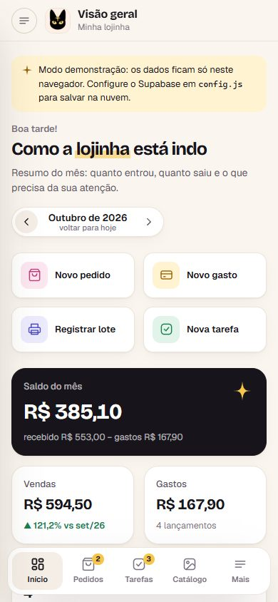

# Painel da Lojinha

A web dashboard to run a small handmade shop: pricing, a catalog with print settings, supplies, expenses, orders and production batches.

It is a **React** single-page app that stores data in **Supabase**, behind a login.
Without Supabase configured, it runs in **demo mode**, with sample data saved only in the browser.


The interface is in Portuguese (pt-BR). Screen names below are shown as they appear in the app, with a translation in parentheses.

## Features

The sidebar groups the screens by topic. On mobile it becomes a slide-out menu plus a bottom bar with the most used screens.

| Group | Screen | What it does |
|---|---|---|
| Dia a dia (day to day) | **Visão geral** (overview) | Monthly profit and margin, sales, cash flow, a sales vs. expenses chart, products ranked by profit or by pieces, sales by channel and a "Precisa de atenção" (needs attention) list with one-click actions. |
| | **Tarefas** (tasks) | To-do list with due dates, priority and tags, grouped by overdue / today / next 7 days. |
| | **Pedidos** (orders) | Sales by channel, net amount after fees and shipping, invoice number and status. |
| Produtos (products) | **Catálogo** (catalog) | Product cards with artwork, ready stock and print settings (paper, size, color adjustments), plus a print queue. |
| | **Preços** (pricing) | Cost per piece from supplies, labor and waste, suggested price and margin per product. |
| | **Produção** (production) | Production batches; each batch adds ready pieces and consumes supplies. |
| Estoque e dinheiro (stock and money) | **Insumos** (supplies) | Supply stock, low-stock alerts and average cost. |
| | **Gastos** (expenses) | Everything paid out; purchases linked to a supply add to its stock. |
| | **Ajustes** (settings) | Default hourly rate, margin, fees and waste; appearance; backup and restore. |

Filters live in the address (for example `#/pedidos?status=enviado`), so a filtered view can be bookmarked and the back button works. Addresses from the previous version (`#pedidos`) still open the right screen.

### Appearance

A clean black-and-white style. Color only appears as small status dots (green ok, orange attention, red problem).
**Dark theme is the default**; it can be switched to **Claro / Escuro / Automático** (light / dark / follows the device) in the sidebar footer, in **Ajustes → Aparência**, or with the sun/moon button on the phone. The choice is saved per browser (`localStorage` key `painel-tema`).

| Light theme | Mobile |
|---|---|
|  |  |

### Design system

Tokens (colors, type, radius, breakpoints) are the Tailwind theme in [`src/styles/index.css`](src/styles/index.css); the reusable components are in [`src/components/ui/`](src/components/ui/). Rules and usage: [`docs/design-system.md`](docs/design-system.md). Visual catalog with every component in both themes: **Storybook** (`npm run storybook`).

## Tech stack

| Area | Tools |
|---|---|
| UI | [React 19](https://react.dev) + [TypeScript](https://www.typescriptlang.org) |
| Build and dev server | [Vite](https://vite.dev) |
| Styles | [Tailwind CSS 4](https://tailwindcss.com), with the design tokens as its theme; [Geist](https://vercel.com/font) font, self-hosted |
| Routing | [TanStack Router](https://tanstack.com/router) (hash URLs, each screen loaded on demand, filters validated in the address) |
| Data | [TanStack Query](https://tanstack.com/query) (one cached query, optimistic saves with rollback) over [Supabase](https://supabase.com) (Postgres, Auth, Storage) |
| Forms | [React Hook Form](https://react-hook-form.com) + [Zod](https://zod.dev) (validation with messages in Portuguese) |
| Component catalog | [Storybook 10](https://storybook.js.org) with accessibility checks (axe) |
| Tests | [Vitest](https://vitest.dev) + [Testing Library](https://testing-library.com) (unit and component), [Playwright](https://playwright.dev) (end to end) |
| Quality | ESLint (typescript-eslint, React Hooks rules), Prettier (with Tailwind class sorting) |
| Hosting | Netlify (static `dist/`) |

## 1. Create the database in Supabase (free)

1. Create an account at https://supabase.com and a new project (region: São Paulo).
2. Open **SQL Editor → New query**, paste the contents of [`supabase/schema.sql`](supabase/schema.sql) and click **Run**.
3. Create your user in **Authentication → Users → Add user → Create new user** (email and password; check *Auto Confirm User*).
4. Close public sign-ups: **Authentication → Sign In / Providers → turn off "Allow new users to sign up"**.
5. In **Project Settings → API**, copy the **Project URL** and the **anon public** key into `VITE_SUPABASE_URL` and `VITE_SUPABASE_ANON_KEY` in [`netlify.toml`](netlify.toml) (for the published site) and, to use them locally, in a `.env.local` file (see [`.env.example`](.env.example)).

> The *anon* key is meant to live in the site. Data is protected by the login and by the database rules:
> each account only sees its own records. Never put the *service_role* key in the site.

## 2. Deploy the site

The site is built into `dist/` (`npm run build`).

- **Netlify** (in use): connect the GitHub repository; [`netlify.toml`](netlify.toml) runs the unit tests, builds and publishes `dist/`. Every pull request gets a preview.
- **Vercel**: import the repository; [`vercel.json`](vercel.json) has the build command and output folder. Set the two `VITE_SUPABASE_*` variables in the project settings.

After deploying, go back to Supabase, open **Authentication → URL Configuration** and set the site address as **Site URL**. That is where the "Esqueci minha senha" (forgot my password) link sends people.

## 3. Run it locally

Requires Node.js 22.

```bash
npm install
```

```bash
npm run dev
```

Then open http://localhost:3737. On Windows you can also double-click `iniciar.bat`.
Without a `.env.local` the app opens in demo mode; with one, it uses that Supabase project.

> On Windows PowerShell, `npm` may fail with "execution of scripts is disabled". Use `npm.cmd` instead (`npm.cmd run dev`).

| Command | What it does |
|---|---|
| `npm run dev` | Development server with instant reload |
| `npm run build` | Type check + production build into `dist/` |
| `npm run preview` | Serves the production build |
| `npm run storybook` | Component catalog at http://localhost:6006 |
| `npm run lint` · `npm run typecheck` | ESLint · TypeScript |
| `npm run format` · `npm run format:check` | Prettier |
| `npm run test:unit` · `npm run test:e2e` · `npm test` | Tests (below) |

## 4. Tests

| Command | What it checks | Tool |
|---|---|---|
| `npm run test:unit` | The calculations (`src/domain/calc.ts`): supply cost, product cost and suggested price, stock, order totals, the month summary, monthly profit (and that profit per product adds up to it), batches, tasks, backup and restore, plus a regression check on the sample data (October 2026 profit R$ 413,56). Also formatting helpers and UI components (confirmation button, toggle group, form field errors linked to the input). | Vitest + Testing Library |
| `npm run test:e2e` | The production build in a browser, in demo mode: every screen, the overview numbers, creating/editing/deleting an order, form validation, filters in the address, tasks, settings, light/dark/auto theme, the phone layout, and accessibility (dialog focus, keyboard tooltips, skip link, chart text). | Playwright |
| `npm test` | Both. | |

The end-to-end tests use your installed Google Chrome (or run `npx playwright install chromium` and remove `channel: 'chrome'` from `playwright.config.ts`). They build the app and serve it on port 3999 with empty Supabase settings, so they always run in demo mode. The clock is fixed on 20 October 2026 so the sample data falls in the current month. Desktop runs at 1440×900; `mobile.spec.ts` on a Pixel 7.

**Automatic runs on Netlify.** Every build (production and pull request previews) runs `npm run test:unit` and the type check first. If either fails, the build fails, the pull request shows a failed Netlify check, and **the site is not published**. End-to-end tests need a browser, so run `npm run test:e2e` locally before merging changes to screens or flows.

## Getting started in the dashboard

A new account starts empty. On **Visão geral** you can load sample data to see everything working.
To remove it all at once: **Ajustes → Apagar registros de exemplo** (delete sample records).
**Ajustes** also lets you download a backup (JSON) and restore one.

## How the numbers are calculated

- **Supply cost**: average of what you paid in the purchases recorded under Gastos ((price + shipping) ÷ quantity). Without purchases, it uses the cost entered on the supply.
- **Product cost**: materials (quantity ÷ yield × supply cost) + waste % + labor (minutes ÷ 60 × hourly rate) + other costs.
- **Suggested price**: cost × (1 + margin) ÷ (1 − platform fee), rounded up to end in ,90.
- **Lucro do mês** (monthly profit): the month's sales (excluding cancelled orders) − cost of the pieces sold − platform fees and shipping cost. The cost of each piece is the product cost above, at today's supply costs, so it includes your time at the hourly rate. Margin = profit ÷ sales.
- **Caixa do mês** (monthly cash flow): money received from the month's orders (after fees and shipping) − everything recorded under Gastos in the month. It differs from profit when you buy supplies in one month and use them in another.
- **Profit per product** (ranking on the overview): sales of that product − cost of its pieces − its share of the order's fees and discounts (split by revenue). The products' profits plus net shipping add up to the monthly profit.
- **Supply stock**: initial stock + purchases − what production batches consumed.
- **Ready pieces**: initial stock + produced batches − orders (excluding cancelled ones).

## Code conventions

- **Layers.** `domain/` has the types and pure calculations (no React); `data/` talks to Supabase or the browser and exposes TanStack Query hooks; `components/ui/` has the reusable visual components; `features/` has one folder per screen with its page and form; `app/` has the shell, routes and theme.
- **Data flow.** Screens read with `useDb()` / `useCalc()` and write with `useSave()` / `useRemove()`. Never call Supabase from a screen. Data is immutable: every change makes a new `Db`, so `createCalc(db)` can cache results safely.
- **Stored format.** Records are saved exactly as before the React version (numbers typed in forms are kept as text, read with `num()`), so existing data keeps working.
- **Forms.** React Hook Form + a Zod schema per form; fields come from `components/ui/Field.tsx` and saving from `features/forms/formKit.ts`. Forms open through `useOpenForm()` (`FormHost`).
- **Styles.** Tailwind utilities with the design tokens only (no default palette); shared looks become components, not copied class lists.
- **Accessibility** is part of each component (labels, focus, keyboard, text alternatives) and covered by end-to-end tests and Storybook's axe checks.
- **Language.** Code, comments and docs in English; text the user sees in Portuguese. Identifiers that already existed in Portuguese (`custo`, `resumoMes`, field names like `valorHora`) are kept because they match the stored data.

## Project structure

```
index.html              page shell (applies the saved theme before the first paint)
src/
  main.tsx              starts React, TanStack Query and the router
  app/                  shell (sidebar, top and bottom bars), routes, tabs, theme
  auth/                 session (Supabase Auth) and the login screen
  components/ui/        design-system components and their Storybook stories
  data/                 repository (Supabase or demo), query hooks, backup, images, sample data
  domain/               types, constants and calculations (+ unit tests)
  features/<screen>/    each screen and its form
  lib/                  formatting, dates, class names, errors
  styles/index.css      Tailwind theme (design tokens) and base styles
public/                 static files copied as they are (logo, service-worker remover)
supabase/schema.sql     table, access rules and image bucket
tests/e2e/              end-to-end tests (Playwright)
.storybook/             Storybook settings (theme switch, accessibility checks)
docs/                   design system and screenshots (not deployed)
```
